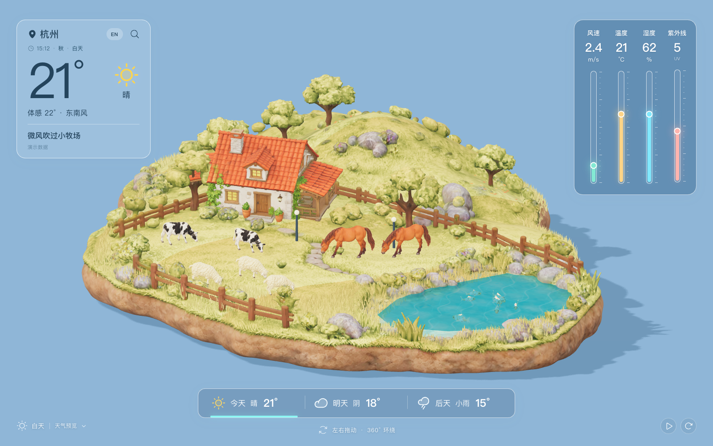
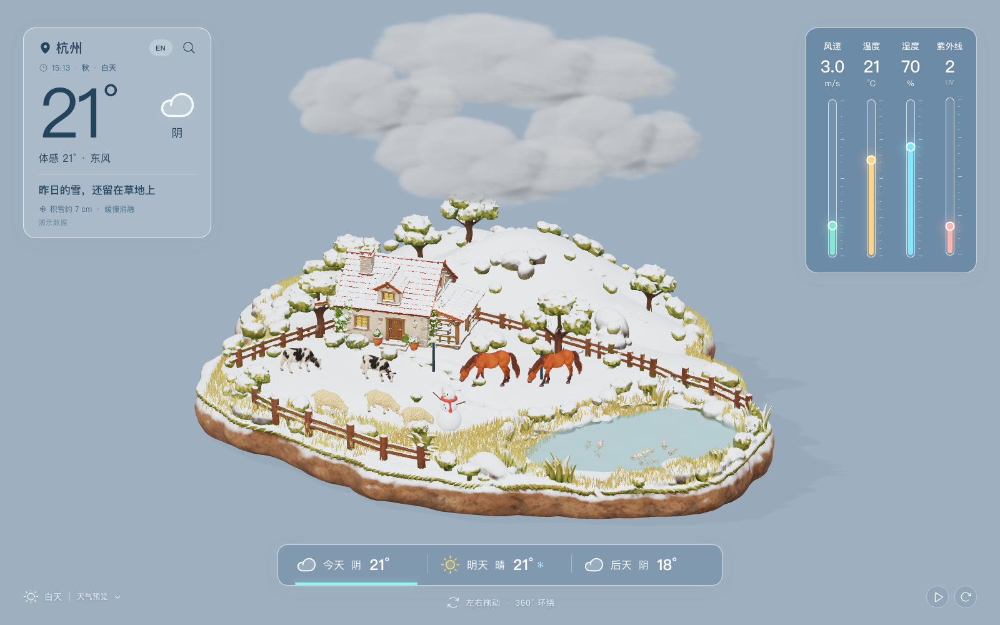
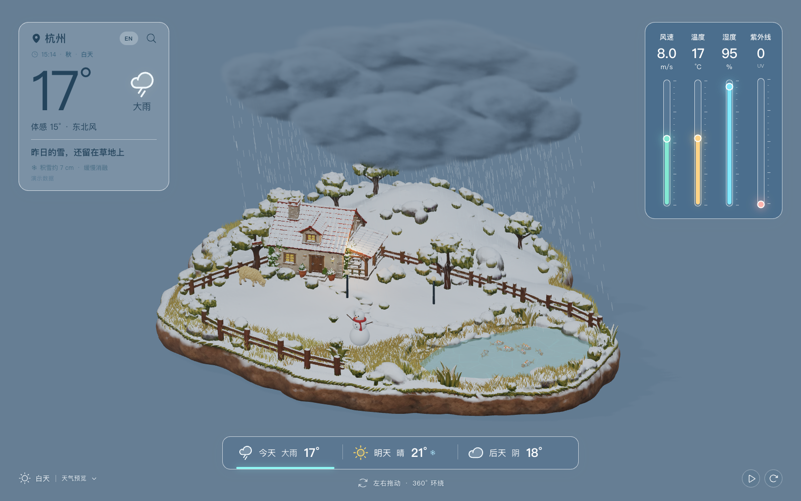
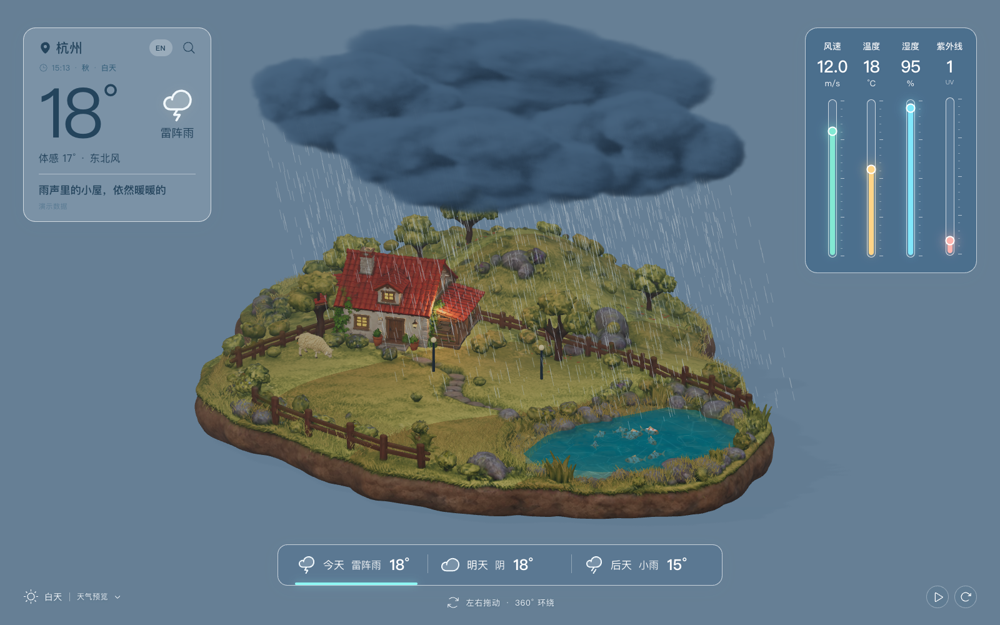
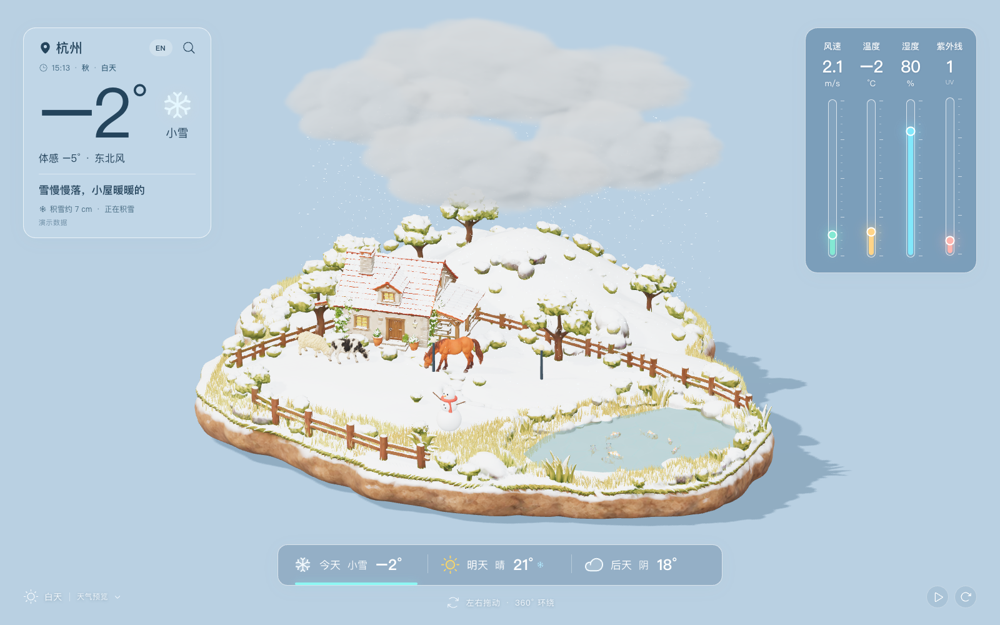
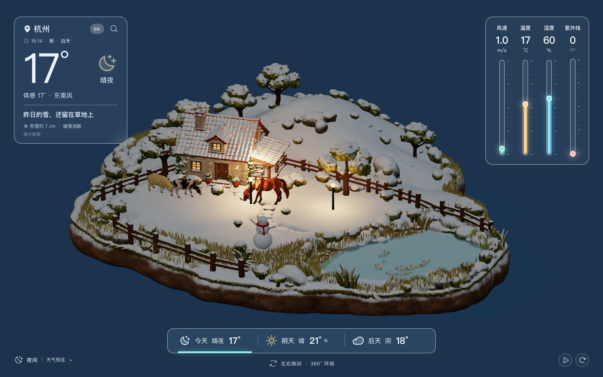

<div align="center">

# 3DWeather · Pocket Pasture

**A living miniature pasture in your browser — real-time 3D weather, seasons, and daylight, rendered with Three.js.**

English | [简体中文](README.zh-CN.md)

[](https://threejs.org/)
[](https://react.dev/)
[](https://vite.dev/)
[](https://nodejs.org/api/test.html)



*A finite miniature island: cottage, meadow, pond, and hill — fully modeled on every side. Drag to orbit 360°.*

</div>

---

## Overview

**Pocket Pasture** (小牧场) is a browser-based 3D weather scene. Instead of a flat dashboard, weather plays out on a hand-built miniature pasture: volumetric clouds gather over the hill, rain falls from real cloud undersides, lightning forks beneath the storm cell, and snow accumulates overnight and survives into the next sunny day.

The environment is driven by your **local clock** — season, sun position, and daylight phase (dawn / day / dusk / night) all follow the viewer's time. The UI is bilingual (English / 简体中文) with a persistent language toggle.

> The scene currently runs on **demo weather data**. A clean `window.PocketWeather` API is exposed for wiring up a real provider — see [Weather data integration](#weather-data-integration).

## Weather states

Ten distinct states, each with its own cloud anatomy, particle systems, and lighting:

| Condition key | English | 中文 | Scene highlights |
| --- | --- | --- | --- |
| `sunny` | Sunny | 晴 | Clear sky, sharp shadows, no clouds |
| `cloudy` | Cloudy | 阴 | 4 stratocumulus layers, diffuse gray lighting |
| `rain` | Light rain | 小雨 | 2 thin rain clouds, sparse streaks |
| `moderateRain` | Moderate rain | 中雨 | 3 layered rain clouds, denser streaks & ripples |
| `heavyRain` | Heavy rain | 大雨 | 4 thick clouds, dark sky, heavy streaks |
| `storm` | Thunderstorm | 雷阵雨 | Cloud-internal flashes + branched 3D lightning, optional thunder |
| `snow` | Light snow | 小雪 | 4 soft stratus clouds; snow **accumulates and persists** across days |
| `fog` | Foggy | 薄雾 | Soft low-visibility haze |
| `windy` | Windy | 有风 | Grass and trees sway strongly |
| `night` | Clear night | 晴夜 | Cottage windows and path lamps glow |

<div align="center">

| Cloudy | Heavy rain |
| --- | --- |
|  |  |
| **Thunderstorm** | **Snow** |
|  |  |
| **Clear night** (earlier snowfall persists on the trees) | |
|  | |

</div>

## Features

### Scene & camera
- Finite miniature island — cottage, terrain, trees, fences, pond and hill exist on **all sides**, rewarding a full 360° orbit
- Drag to orbit around the vertical Y axis at a fixed, gently elevated angle; wheel to zoom, auto-orbit and view-reset buttons, arrow keys + `R` keyboard control
- One **shared orthographic framing** (14.5 units tall on desktop) across every weather state — switching weather never zooms or pans the camera

### Weather visuals
- **Volumetric clouds** with soft feathered edges, internal density variation, and self-shadowing — rendered from density fields, not billboards or blobs
- Rain and snow spawn at **real cloud-base coordinates** sampled from the density voxels, then fall to terrain height; wind displacement grows as drops fall. Transparent clouds occlude rain behind them
- Three rain grades change cloud count, thickness, coverage, darkness, streak density/length and scene lighting; thunderstorm stays a separate state
- Lightning roots inside a substantial cloud underside: white trunk, fine branches, pale-blue halo, cloud-internal illumination, repeatable preview from the weather menu, optional thunder sound (muted by default)
- Autumn leaves detach from the **actual tree-crown surface points** of the terrain mesh (`tree-anchors.json`), tumble, and settle on bare ground beside each tree
- Snow accumulates on upward-facing surfaces, is **saved per city in the browser**, melts slowly (0.012/hour), and survives reloads and later sunny days

### Environment & seasons
- Local clock drives dawn / day / dusk / night: sun position, sky, ambient light, cottage lamps all follow
- Local month drives the season: autumn yellows the vegetation; winter lays snow cover and adds a snowman
- Animals respond to weather — fewer venture out in rain and at night

### UI
- Frosted-glass weather card (top-left), four live vertical gauges — wind speed, temperature, humidity, UV (right side), clickable 3-day forecast, demo city search
- **English / 简体中文** toggle, persisted in the browser
- Explicit load progress with failure retry
- Desktop-first web experience; narrow viewports get responsive layout only

## Tech stack

- **Three.js** (WebGL) — scene, volumetric clouds, particles, skeletal animation (`AnimationMixer`)
- **React 19** — UI state and overlay components
- **Vite 6** — dev server and build
- **Node test runner** — unit tests for weather normalization, rain grading, environment, spatial effects, camera, assets
- **Blender** (offline pipeline) — asset processing, rigging, cloud volume generation

## Getting started

Requires **Node.js 18+**.

```sh
npm install
npm run dev          # http://localhost:5173
```

Other commands:

```sh
npm test             # unit tests (weather, rain, environment, spatial, camera, assets)
npm run build        # outputs dist/client/, keeps Sites-compatible worker files
npm run test:sites   # worker/hosting contract tests
```

## Project structure

```
src/
  world.js           # Three.js scene: island, models, lights, water
  camera.js          # shared orthographic framing + 360° orbit control
  clouds.js          # volumetric cloud rendering (density fields)
  rain.js            # rain grading + precipitation particles
  storm.js           # lightning bolts, cloud illumination, thunder
  leaves.js          # instanced autumn leaves from tree anchors
  spatial-effects.js # cloud layouts, leaf trajectories, lightning timing
  weather.js         # weather state normalization (normalizeWeather)
  i18n.js            # English / 简体中文 strings
  App.jsx            # UI state, weather card, gauges, forecast
  main.jsx           # entry
public/assets/       # runtime models (GLB), cloud density bins, audio
assets/              # editable sources: Blender files, Tripo originals, VDB volumes
scripts/             # Blender + Node asset pipeline
tests/               # node --test suites
docs/                # guides, QA screenshots, Tripo task records
```

## Weather data integration

The scene updates through a stable runtime API — point it at a real backend or provider without touching the 3D code:

```js
// optional preview/debug override
window.PocketWeather.setEnvironment({ season: "autumn", phase: "day", hour: 12 });

window.PocketWeather.update({
  city: 'Hangzhou',
  condition: 'rain', // sunny/cloudy/rain/moderateRain/heavyRain/storm/snow/fog/windy/night
  temperature: 19,   // °C
  feelsLike: 18,
  wind: 4.2,         // m/s
  humidity: 88,      // %
  uv: 1,
  precipitation: 86, // %
  direction: 'NE',
  observedAt: new Date().toISOString(),
  source: 'api',
});
```

`normalizeWeather` (`src/weather.js`) clamps values and fills missing fields. **Keep API keys server-side** — the page currently ships no keys, no geolocation, and no external requests. The 3-day forecast is demo data; replace the `forecasts` source in `src/App.jsx` when wiring a forecast endpoint.

## Asset pipeline

All hero assets were generated from reference images (image-to-3D via Tripo), then rigged and processed locally in Blender. Originals are preserved under `assets/`; the web app only loads optimized copies from `public/assets/`.

| Asset | Web file | Editable source | Animation |
| --- | --- | --- | --- |
| Cottage | `models/cottage.glb` | `assets/cottage.blend` | Static; night window/lamp materials |
| Terrain (meadow, hill, trees, fences, pond) | `models/terrain.glb` | `assets/terrain-layout.blend` | Static; grass, water & snow shader layers |
| Cow / sheep / horse | `models/*.glb` | `assets/*-animation.blend` | 13 bones each; `Graze` 4s, `Walk` 2s clips |
| Koi | `models/fish.glb` | `assets/koi-swim.blend` | 3 bones; `Swim` 2s + swim paths |
| Clouds | `clouds/*.density.bin` | `assets/cloud-volumes/*.blend` + `.vdb` | Volumetric rendering in `src/clouds.js` |
| Autumn leaves | `models/autumn-leaf.glb` + `tree-anchors.json` | `assets/autumn-leaf.blend` | Instanced in `src/leaves.js` |
| Thunder | `audio/thunder.wav` | `scripts/create-thunder.py` | Synthesized; delayed after flash |

Regenerate editable sources from the originals (Blender required):

```sh
/Applications/Blender.app/Contents/MacOS/Blender --background --python scripts/prepare-terrain.py
/Applications/Blender.app/Contents/MacOS/Blender --background --python scripts/create-companion-assets.py
/Applications/Blender.app/Contents/MacOS/Blender --background --python scripts/create-cloud-volumes.py
/Applications/Blender.app/Contents/MacOS/Blender --background --python scripts/prepare-tree-effects.py
/Applications/Blender.app/Contents/MacOS/Blender --background --python scripts/animate-animals.py   # -- horse rebuilds the horse only
```

More detail: [animation & Blender editing guide](docs/animation-guide.md) · [visual target](docs/visual-target.png) · [Tripo task records](docs/tripo/tasks.json)

## Roadmap

- [ ] Connect a real weather provider (keys held by a backend; reuse `window.PocketWeather.update`)
- [ ] Replace the demo 3-day forecast with a forecast API
- [ ] Deploy (the Sites-compatible worker/hosting build is already tested)

## Acknowledgements

- [Three.js](https://threejs.org/), [React](https://react.dev/), [Vite](https://vite.dev/)
- Image-to-3D asset generation via [Tripo](https://www.tripo3d.ai/), refined in [Blender](https://www.blender.org/)
- The selected visual direction is archived at [`docs/visual-target.png`](docs/visual-target.png)
