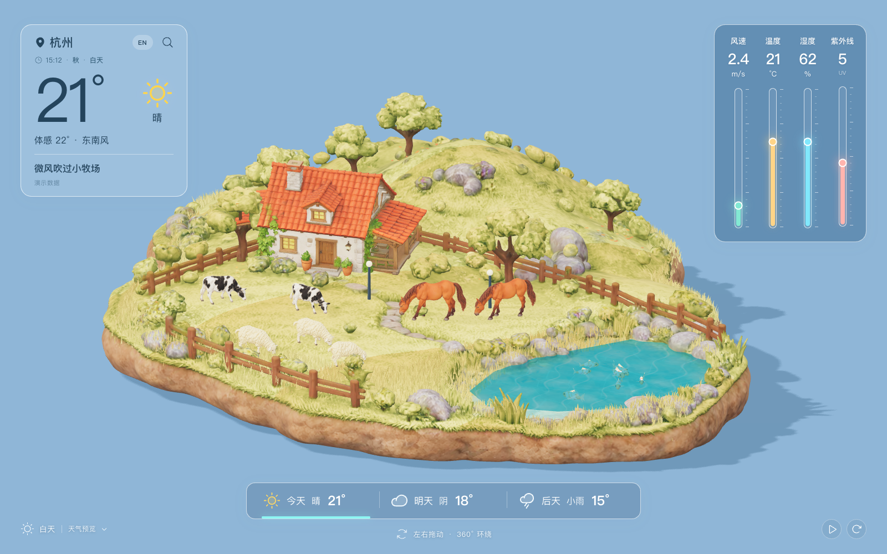
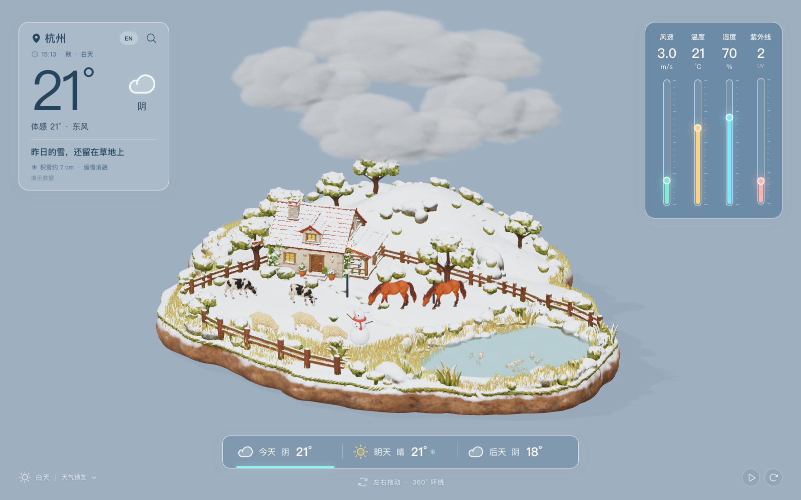
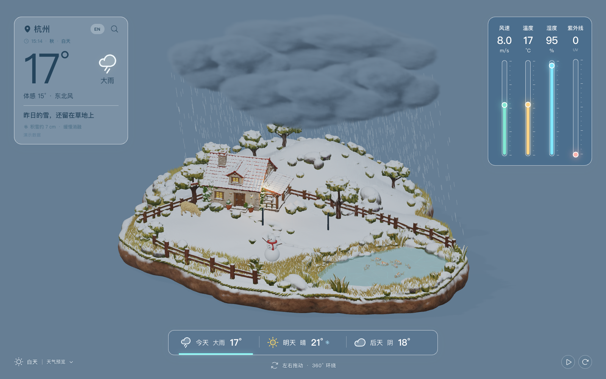
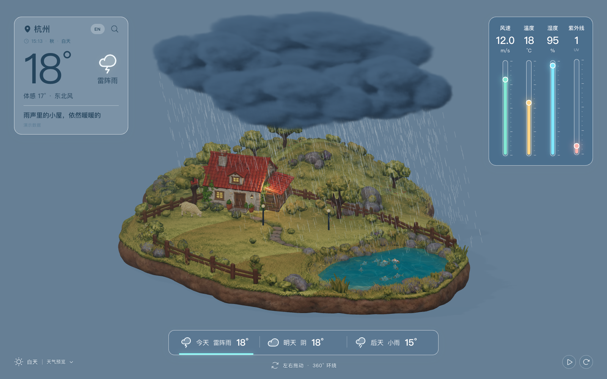
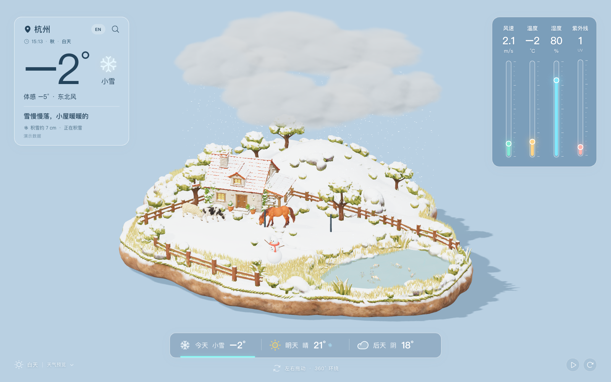
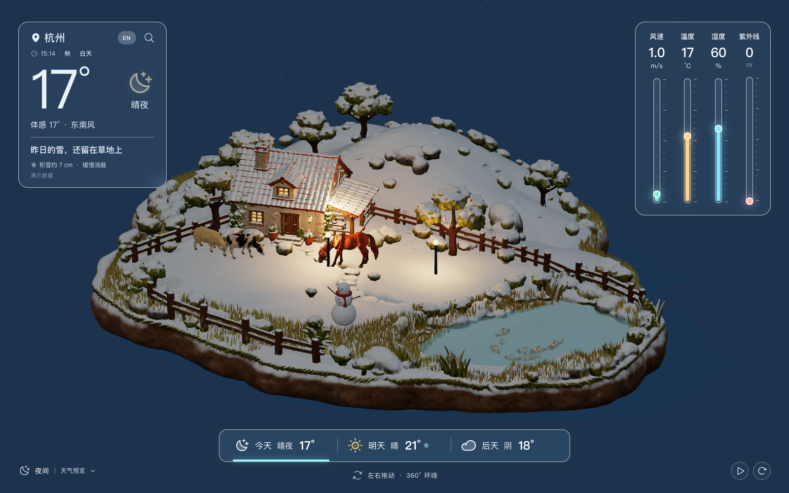

<div align="center">

# 3DWeather · 小牧场

**运行在浏览器里的活体微缩牧场 —— Three.js 实时渲染的 3D 天气、季节与昼夜。**

[English](README.md) | 简体中文

[](https://threejs.org/)
[](https://react.dev/)
[](https://vite.dev/)
[](https://nodejs.org/api/test.html)



*一块完整的微缩浮岛：房屋、草甸、池塘与山丘，每一面都有真实结构。拖动即可 360° 环绕。*

</div>

---

## 简介

**小牧场**（Pocket Pasture）是一个运行在浏览器里的 3D 天气网页。天气不再是一张平面面板，而是在手工搭建的微缩牧场上实时上演：体积云在后山上空聚集，雨丝从真实云底落下，闪电在雨云下分叉，积雪过夜堆积、直到第二天晴天仍然保留。

场景环境由**观看者的本地时间**驱动 —— 季节、太阳方位与昼夜阶段（清晨/白天/黄昏/夜间）全部跟随本地时钟。界面支持**中文/英文**切换，语言偏好保存在浏览器中。

> 当前使用**演示天气数据**。页面暴露了稳定的 `window.PocketWeather` 运行时接口，接入真实天气服务无需改动 3D 代码，见[天气数据接入](#天气数据接入)。

## 天气状态

十种状态，每种都有独立的云形、粒子与光照设计：

| 条件键值 | 英文 | 中文 | 场景要点 |
| --- | --- | --- | --- |
| `sunny` | Sunny | 晴 | 无云，清晰投影 |
| `cloudy` | Cloudy | 阴 | 4 片层积云，灰调漫射光 |
| `rain` | Light rain | 小雨 | 2 片薄雨云，稀疏雨丝 |
| `moderateRain` | Moderate rain | 中雨 | 3 片连绵雨云，更密的雨丝与涟漪 |
| `heavyRain` | Heavy rain | 大雨 | 4 片厚云，天色变暗，雨势密集 |
| `storm` | Thunderstorm | 雷阵雨 | 云内闪亮 + 云底分叉立体闪电，雷声可选 |
| `snow` | Light snow | 小雪 | 4 片柔和层云；积雪**会累积并跨天保留** |
| `fog` | Foggy | 薄雾 | 低能见度柔雾 |
| `windy` | Windy | 有风 | 草地与树木明显摇曳 |
| `night` | Clear night | 晴夜 | 房屋窗户与路灯点亮 |

<div align="center">

| 阴 | 大雨 |
| --- | --- |
|  |  |
| **雷阵雨** | **小雪** |
|  |  |
| **晴夜**（此前积雪仍留在树上） | |
|  | |

</div>

## 功能特性

### 场景与相机
- 完整的微缩浮岛 —— 房屋、地形、树木、围栏、池塘与山丘**四面都有结构**，环绕一周处处有细节
- 拖动绕 Y 轴 360° 环绕，俯视角度固定；滚轮缩放、自动环绕与视角复位按钮，支持左右方向键与 `R` 键
- 所有天气共用同一套**固定正交取景**（桌面视口高 14.5 单位）—— 切换天气不会改变镜头比例、倾角或目标

### 天气视觉
- **体积云**：柔边、内部疏密与自阴影，由密度场渲染而成，拒绝贴图云与光滑实体云
- 雨雪粒子从密度体素计算出的**真实云底坐标**生成，落到地形高度；风的横向位移随下落距离增加；透明云体会遮挡后方雨丝
- 小/中/大三档雨量同时改变云的数量、厚度、覆盖、明暗、雨丝密度/长度与场景光照；雷阵雨是独立状态，大雨不等于闪电
- 闪电扎根于厚实云底内部：白色主干、细分支、淡蓝光晕、云内照明；天气菜单可重复演示，雷声默认静音、由用户开启
- 秋叶从地形网格的**真实树冠表面点**（`tree-anchors.json`）脱落，轻微翻转后落在树旁裸地并停留
- 积雪覆盖朝上的表面，**按城市保存在浏览器中**，每小时消融 0.012，重新载入和之后的晴天都保留

### 环境与季节
- 本地时钟划分清晨/白天/黄昏/夜间：太阳方位、天空、环境光、房屋与路灯随之变化
- 本地月份决定季节：秋天植被变黄、落叶；冬天地表积雪并出现雪人
- 动物对天气有反应：雨天与夜间外出的动物减少

### 界面
- 左上毛玻璃天气卡、右侧风速/温度/湿度/紫外线四条动态仪表、可点击三日预报、演示城市搜索
- **中文/英文**一键切换，选择持久保存
- 明确的载入进度与失败重试
- 以桌面端为主；窄窗口仅做响应式适配，不提供 App 打包或安装提示

## 技术栈

- **Three.js**（WebGL）—— 场景、体积云、粒子、骨骼动画（`AnimationMixer`）
- **React 19** —— 界面状态与浮层组件
- **Vite 6** —— 开发与构建
- **Node 内置测试** —— 天气归一化、雨量分级、环境、空间效果、相机、素材单测
- **Blender**（离线管线）—— 素材处理、绑定、云体生成

## 快速开始

需要 **Node.js 18+**。

```sh
npm install
npm run dev          # http://localhost:5173
```

其他命令：

```sh
npm test             # 单元测试（weather/rain/environment/spatial/camera/assets）
npm run build        # 输出 dist/client/，保留 Sites 兼容的 worker 文件
npm run test:sites   # worker/hosting 契约测试
```

## 项目结构

```
src/
  world.js           # Three.js 场景：浮岛、模型、灯光、水面
  camera.js          # 共享正交取景 + 360° 环绕控制
  clouds.js          # 体积云渲染（密度场）
  rain.js            # 雨量分级与降水粒子
  storm.js           # 闪电、云内照明、雷声
  leaves.js          # 基于树锚点的实例化秋叶
  spatial-effects.js # 云的空间布局、叶片轨迹、闪电时序
  weather.js         # 天气状态归一化（normalizeWeather）
  i18n.js            # 中英文文案
  App.jsx            # 界面状态、天气卡、仪表、预报
  main.jsx           # 入口
public/assets/       # 运行时模型（GLB）、云密度文件、音频
assets/              # 可编辑源文件：Blender 工程、Tripo 原始模型、VDB 体素
scripts/             # Blender 与 Node 素材管线
tests/               # node --test 测试
docs/                # 说明、QA 截图、Tripo 任务记录
```

## 天气数据接入

页面通过稳定的运行时接口更新，接入真实后端或供应商无需改动 3D 代码：

```js
// 可选的预览/调试覆盖
window.PocketWeather.setEnvironment({ season: "autumn", phase: "day", hour: 12 });

window.PocketWeather.update({
  city: '杭州',
  condition: 'rain', // sunny/cloudy/rain/moderateRain/heavyRain/storm/snow/fog/windy/night
  temperature: 19,   // °C
  feelsLike: 18,
  wind: 4.2,         // m/s
  humidity: 88,      // %
  uv: 1,
  precipitation: 86, // %
  direction: '东北风',
  observedAt: new Date().toISOString(),
  source: 'api',
});
```

`src/weather.js` 的 `normalizeWeather` 处理缺失值、异常值与数值边界。**真实 API 密钥应放在后端** —— 当前页面没有密钥、定位或外部请求。三日预报目前是演示数据，接入预报接口时替换 `src/App.jsx` 的 `forecasts` 数据来源。

## 素材管线

主要素材均由参考图生成（Tripo 图生三维），再在本地 Blender 中绑定与处理。原始文件保留在 `assets/`；网页只加载 `public/assets/` 的优化版本，不包含早期未采用的素材库候选。

| 素材 | 网页文件 | 可编辑来源 | 动画方式 |
| --- | --- | --- | --- |
| 房屋 | `models/cottage.glb` | `assets/cottage.blend` | 静态；夜间窗户与路灯材质变化 |
| 地形（草甸、山、树、围栏、池岸） | `models/terrain.glb` | `assets/terrain-layout.blend` | 静态主体；叠加草叶、水面与积雪材质 |
| 牛 / 羊 / 马 | `models/*.glb` | `assets/*-animation.blend` | 每种 13 根骨骼，`Graze` 4 秒、`Walk` 2 秒 |
| 锦鲤 | `models/fish.glb` | `assets/koi-swim.blend` | 3 根骨骼，`Swim` 2 秒，加游动路线 |
| 云 | `clouds/*.density.bin` | `assets/cloud-volumes/*.blend` + `.vdb` | `src/clouds.js` 体积渲染，按天气控制密度、光照与漂移 |
| 秋叶 | `models/autumn-leaf.glb` + `tree-anchors.json` | `assets/autumn-leaf.blend` | `src/leaves.js` 实例化；真实树冠表面到树旁地面 |
| 雷声 | `audio/thunder.wav` | `scripts/create-thunder.py` | 本地合成；闪电后延迟播放 |

从原始 GLB 重新生成来源与动作（需要 Blender）：

```sh
/Applications/Blender.app/Contents/MacOS/Blender --background --python scripts/prepare-terrain.py
/Applications/Blender.app/Contents/MacOS/Blender --background --python scripts/create-companion-assets.py
/Applications/Blender.app/Contents/MacOS/Blender --background --python scripts/create-cloud-volumes.py
/Applications/Blender.app/Contents/MacOS/Blender --background --python scripts/prepare-tree-effects.py
/Applications/Blender.app/Contents/MacOS/Blender --background --python scripts/animate-animals.py   # -- horse 可单独重建马
```

更多细节：[动画与 Blender 编辑说明](docs/animation-guide.md) · [视觉目标图](docs/visual-target.png) · [Tripo 任务记录](docs/tripo/tasks.json)

## 路线图

- [ ] 接入真实天气供应商（密钥放在后端；复用 `window.PocketWeather.update`）
- [ ] 用预报 API 替换演示三日预报
- [ ] 部署上线（Sites 兼容的 worker/hosting 构建已通过测试）

## 致谢

- [Three.js](https://threejs.org/)、[React](https://react.dev/)、[Vite](https://vite.dev/)
- 素材由 [Tripo](https://www.tripo3d.ai/) 图生三维生成，[Blender](https://www.blender.org/) 精修
- 选定的视觉方向存档于 [`docs/visual-target.png`](docs/visual-target.png)
