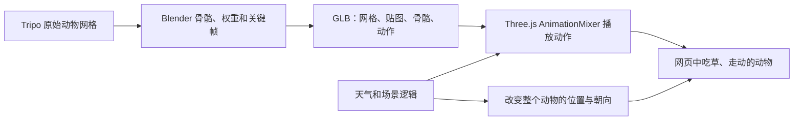

# 这座小牧场是怎么动起来的

房屋、地形、动物和鱼都是实际的三维网格。动物的动作分成两层：Blender 制作身体的形变，Three.js 决定动物在牧场中的位置、朝向以及当前播放哪个动作。

## 身体形变和移动路线

以牛为例，网格上有不同的骨骼权重。`Head` 骨骼轻轻转动时，头部顶点跟着改变位置；腿骨交替摆动时，腿部网格产生走路动作。`Graze` 包含小幅低头、摆尾和呼吸，`Walk` 包含腿部摆动。

这些动作导出到 GLB 后，网页的 `AnimationMixer` 每帧推进动作。下雨或夜晚时，Three.js 再把剩下的几只动物移到屋旁，并在移动期间从吃草平滑切换到行走。走到目标位置后恢复吃草。每只动物有独立骨架和播放时间，因此不会整齐地同步摆动。

鱼的 `Swim` 片段负责身体和尾部摆动，网页另外计算池塘内的椭圆游动路线和朝向。单独在 Blender 播放鱼的动作时，它会原地摆尾；进入网页后才会一边摆尾一边在水中游动。

## 已交付的 Blender 文件

以下路径都相对于项目根目录。

| 源文件 | 网页素材 | 动作 | 源文件帧范围 |
| --- | --- | --- | --- |
| `assets/cow-animation.blend` | `public/assets/models/cow.glb` | `Graze` / `Walk` | 1–97 / 1–49 |
| `assets/sheep-animation.blend` | `public/assets/models/sheep.glb` | `Graze` / `Walk` | 1–97 / 1–49 |
| `assets/horse-animation.blend` | `public/assets/models/horse.glb` | `Graze` / `Walk` | 1–97 / 1–49 |
| `assets/koi-swim.blend` | `public/assets/models/fish.glb` | `Swim` | 1–49 |
| `assets/cottage.blend` | `public/assets/models/cottage.glb` | 静态模型 | — |
| `assets/terrain-layout.blend` | `public/assets/models/terrain.glb` | 静态模型 | — |
| `assets/cloud-volumes/cumulus.blend`、`stratus.blend`、`rainLight.blend`、`rainModerate.blend`、`rain.blend` | `public/assets/clouds/*.density.bin` | 体积密度渲染；同目录 `.vdb` 保存可编辑来源 | — |
| `assets/autumn-leaf.blend` | `public/assets/models/autumn-leaf.glb` | 折叠叶片网格；网页控制飘落和翻转 | — |

动物每个骨架有 13 根骨骼，鱼有 3 根；动画帧率为 24 fps。吃草循环长 4 秒，行走和游泳循环长 2 秒。当前动作适合整个微缩牧场的远景观看，绑定保持简单，方便继续调整。

## 在 Blender 中查看和修改

1. 打开相应的 `.blend` 文件，例如 `assets/cow-animation.blend`。
2. 选择骨架对象 `CowRig`；羊、马和鱼分别为 `SheepRig`、`HorseRig`、`KoiSwimRig`。
3. 在动画工作区的动作编辑器中选择 `Graze`、`Walk` 或 `Swim`，将播放范围设为上表对应的帧范围并播放。
4. 调整动作时，进入姿态模式，选择头、腿或尾巴骨骼，在对应帧修改姿态并插入关键帧。循环首尾保持相同姿态。
5. 保存修改后的 `.blend`。导出 glTF 2.0 时使用 GLB 格式，选中网格和骨架，包含动画并导出 `Actions`。保留上述动作名，网页会按名称找到它们。
6. 将导出的文件放到对应的 `public/assets/models/` 路径，重新载入网页检查动作和比例。

运行 `scripts/animate-animals.py` 会从原始 Tripo 文件重建绑定和动作。已手工编辑的源文件应直接导出 GLB；重新运行生成脚本会覆盖它们。

## 不需要骨骼的运动

| 元素 | 当前实现 | 修改入口 |
| --- | --- | --- |
| 云朵 | 晴天无云，阴/雪天 4 片云，小雨 2 片、中雨 3 片、大雨/雷雨 4 片；后山、草地与两侧均在世界坐标中布局 | `src/spatial-effects.js` 的 `CLOUD_BANKS`；`src/world.js` |
| 水面 | 顶点波动、水色和水底光纹，叠加扩散涟漪 | `makeWater` |
| 草叶 | 实例化草叶在着色器中随风摆动 | `makeGrass` |
| 雨、雪 | 雨雪从密度体的实际云底落到地形表面 | `src/world.js` 的 `makeWeatherParticles`、`animate` |
| 秋叶 | 6 棵真实树冠边缘脱落，轻微翻转，落在附近裸地并停留后渐隐；雨雪天暂停 | `src/leaves.js`；`leafPose`；`public/assets/tree-anchors.json` |
| 闪电、雷声 | 云内放电点局部亮闪，云底分叉立体闪电与短促光照；用户开启后延迟播放雷声 | `src/storm.js`；`src/clouds.js`；`stormPulse` |
| 雪人、路灯 | Three.js 基础几何体组成；按季节、积雪和昼夜控制显示及光照 | `makeSnowman`、`makeNightLights` |
| 覆盖的雪 | 材质识别朝上的表面并增加白色覆盖；雪量按城市保存在浏览器中 | `decorateMaterial`；`src/weather.js` |

云的密度加载和体积光照在 `src/clouds.js`，天气编排在 `src/world.js`；表中其他函数位于 `src/world.js`，雪量的存储和逐时消融位于 `src/weather.js`。雪人和路灯的可编辑来源是场景代码；它们无需骨骼或单独的 GLB 文件。

## 本轮核验

`scripts/verify-blender-assets.py` 会实际打开七个 Blender 源文件，检查网格和贴图，并在每个动作的起始帧、四分之一周期及结束帧计算形变后的顶点。

2026-11-01 的核验结果：七个文件均可打开，无缺失贴图；牛、羊、马的吃草/行走和鱼的游泳动作均产生真实网格形变，循环首尾一致。结果保存在 `docs/qa/blender-assets.json`。

云体重新生成：运行 Blender 的 `scripts/create-cloud-volumes.py`，会同步输出五种 96×64×64 R8 密度体、降水起点、OpenVDB 和 `.blend`。密度场决定云的轮廓与疏密，着色器逐步积分产生半透明柔边和自身阴影；不是表面球体，也不是面向镜头的贴图。

`src/rain.js` 将小雨/中雨/大雨分别映射到不同密度体和粒子参数；雷阵雨复用最厚密度体但独立驱动闪电。后山云带较宽，覆盖山顶的三棵树；小雨的两片云也包含后山和草地。所有天气共用 `src/camera.js` 的固定正交取景：桌面视口高度 14.5 单位，窄视口按宽度响应式换算；云布局需要在这个画幅内留出空间，天气切换不改变场景比例或观察目标。

修改落叶时可先在 Blender 编辑 `assets/autumn-leaf.blend` 并导出同名 GLB。树冠起点不是手填坐标：运行 `scripts/prepare-tree-effects.py` 会从保留的地形纹理与网格识别 6 棵树，输出树冠表面点和 `terrain-ground-heights.json` 裸地高度。地形模型变化后应重跑，并检查 `docs/qa/tree-canopy-source-map.png`；测试会比对原模型 SHA-256，防止旧锚点继续配新地形。叶片飞行与落地之间保持连续，随机等待后才重新脱落。

雷电按约 7.6 秒一组间歇，每组先有局部云内微亮，再有数次短闪。闪电所在云带逐次变化，锚点随云的真实云底移动。天气菜单中的“闪电演示 / Preview lightning”可重复触发，“雷声 / Thunder”默认关闭。`scripts/create-thunder.py` 生成原始本地合成音频，不使用外部录音。
